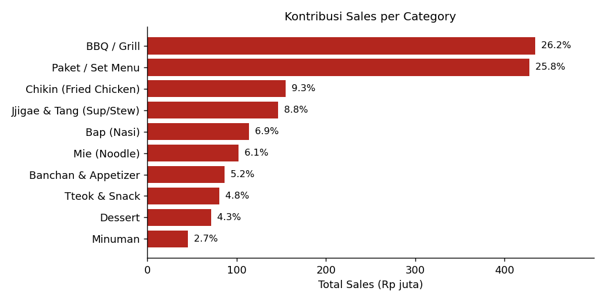

# 🍲 Annyeongbap Korean Restaurant Sales Analysis

[](https://colab.research.google.com/github/Darren0099/annyeongbap-sales-analysis/blob/main/notebooks/analysis.ipynb)



Proyek analisis data end-to-end untuk mengevaluasi **performa penjualan**, **kontribusi kategori menu**, **perbandingan tipe pesanan**, dan **tren bulanan** pada restoran Korea Annyeongbap (Januari - Desember 2025). Proyek ini adalah versi Python dari Final Challenge Excel + VBA (Record Macro, Debugging, dan Sales Analysis Generator).

---

## 🎯 Tujuan
1. **Persiapan data**: menggabungkan tabel transaksi dengan tabel mapping (pengganti VLOOKUP) agar setiap baris punya `order_type`, `category`, `payment_method`, `status`, dan `Month`.
2. **Validasi hasil**: menemukan dan memperbaiki kesalahan hitung Total Sales pada macro `Sales_Check`.
3. **Kontribusi penjualan**: mengukur sales, jumlah transaksi, dan *Average Order Value* (AOV) per kategori menu dan per tipe pesanan.
4. **Tren penjualan**: menentukan bulan terbaik dan pola naik/turun dari line chart bulanan.

---

## 🛠️ Tech Stack
- **Python** (pandas, numpy, matplotlib): merge data, metrik, visualisasi
- **Jupyter / Google Colab**: notebook analisis interaktif
- **VS Code** & **GitHub**: pengembangan dan portofolio
- **Excel + VBA** (sumber tugas asli): PivotTable, PivotChart, dan generator PowerPoint

---

## 📌 Key Performance Indicators (KPIs)
| Metrik | Nilai |
| :--- | ---: |
| Total Sales | **Rp 1.661.714.800** |
| Total Transactions | **7.184** |
| Average Order Value | Rp 231.308 |
| Items Sold | 26.692 porsi |
| Jumlah Menu | 102 menu (10 kategori) |
| Periode | 1 Jan 2025 - 31 Des 2025 |

> Total Sales = jumlah kolom `total` (subtotal dikurangi diskon). Total Transactions dihitung dari `order_id` **unik**, karena satu transaksi bisa berisi banyak baris menu.

---

## 🗂️ Dataset
| Tabel | Baris | Isi |
| :--- | ---: | :--- |
| `transaksi.csv` | 20.000 | Item pesanan (tanggal, menu, harga, qty, subtotal, diskon, total, platform delivery) |
| `mapping_transaksi.csv` | 7.184 | `order_type`, `payment_method`, `status` per `order_id` |
| `mapping_menu.csv` | 102 | `category` per `menu_name` |
| `Data_Dictionary.csv` | 19 | Penjelasan kolom |

---

## ⚙️ Metodologi
1. **Data preparation (Task 1)**: `transaksi` digabung dengan `mapping_transaksi` (kunci `order_id`) dan `mapping_menu` (kunci `menu_name`) menggunakan `merge`. Kolom `Month` dibuat dari `order_date` dengan urutan Jan-Des.
2. **Validasi kualitas data**: cek duplikat, `order_id`/menu tanpa mapping, konsistensi `price × quantity = subtotal` dan `subtotal − discount = total`.
3. **Debugging (Task 2)**: membandingkan penjumlahan kolom `subtotal` (versi macro yang salah) dengan kolom `total` (benar).
4. **Metrik penjualan**: `Sales = Σ total`, `Transactions = jumlah order_id unik`, `AOV = Sales ÷ Transactions`, `Kontribusi = Sales grup ÷ Total Sales`.
5. **Tren bulanan**: penjualan per bulan, bulan terbaik/terendah, dan pola tren memakai kemiringan regresi linear terhadap rata-rata (±5% dianggap datar).
6. **Narrative Analysis**: untuk setiap kategori dan tipe pesanan dihitung top menu, bulan terbaik, dan ringkasan status transaksi (per `order_id` unik).

---

## 📈 Key Results

### Kontribusi Kategori
| Kategori | Sales | Kontribusi | Transaksi | Item |
| :--- | ---: | ---: | ---: | ---: |
| BBQ / Grill | Rp 434,65 jt | 26,16% | 2.477 | 4.032 |
| Paket / Set Menu | Rp 427,87 jt | 25,75% | 1.752 | 2.641 |
| Chikin (Fried Chicken) | Rp 154,61 jt | 9,30% | 1.404 | 2.071 |
| Jjigae & Tang (Sup/Stew) | Rp 146,09 jt | 8,79% | 1.740 | 2.580 |
| Bap (Nasi) | Rp 114,04 jt | 6,86% | 1.781 | 2.628 |
| Mie (Noodle) | Rp 101,77 jt | 6,12% | 1.776 | 2.669 |
| Banchan & Appetizer | Rp 86,08 jt | 5,18% | 1.926 | 2.939 |
| Tteok & Snack | Rp 80,30 jt | 4,83% | 1.671 | 2.517 |
| Dessert | Rp 71,15 jt | 4,28% | 1.420 | 2.123 |
| Minuman | Rp 45,17 jt | 2,72% | 1.691 | 2.492 |

- **BBQ / Grill** adalah kategori terbesar (26,16%), disusul **Paket / Set Menu** (25,75%). Keduanya bersama menyumbang **51,9%** penjualan.
- Penjualan terkonsentrasi pada menu bernilai tinggi: BBQ hanya terjual 4.032 porsi tetapi menghasilkan sales tertinggi.

### Menu Terlaris (berdasarkan Sales)
| Menu | Sales | Kontribusi | Harga |
| :--- | ---: | ---: | ---: |
| Paket Keluarga (5-6 Orang) | Rp 121,82 jt | 7,33% | Rp 480.000 |
| Paket BBQ Party (4 Orang) | Rp 96,25 jt | 5,79% | Rp 350.000 |
| Wagyu Galbi Premium | Rp 66,75 jt | 4,02% | Rp 250.000 |
| Paket Romantic Dinner (2 Orang) | Rp 59,50 jt | 3,58% | Rp 250.000 |
| Paket All You Can Eat BBQ | Rp 43,38 jt | 2,61% | Rp 180.000 |

- **Paket Keluarga** unggul karena harga tertinggi (254 porsi), bukan karena paling sering dipesan. Menu terlaris per porsi adalah **Dwaeji Galbi (307 porsi)**. Jadi Paket Keluarga adalah produk premium penyumbang nilai, bukan unggulan volume.

### Tipe Pesanan
| Order Type | Sales | Kontribusi | Transaksi | AOV |
| :--- | ---: | ---: | ---: | ---: |
| Dine In | Rp 1.061,10 jt | 63,86% | 3.775 | Rp 281.087 |
| Take Away | Rp 310,53 jt | 18,69% | 1.821 | Rp 170.527 |
| Delivery Online | Rp 290,08 jt | 17,46% | 1.588 | Rp 182.671 |

- **Dine In** mendominasi, dengan nilai rata-rata per order 1,6x lebih besar dari Take Away.
- Platform delivery relatif merata: GrabFood 35,4%, GoFood 33,6%, ShopeeFood 30,9%.

### Tren Bulanan
- Bulan terbaik **Desember (Rp 144,67 jt)**, disusul Januari (Rp 143,71 jt) dan Agustus (Rp 143,44 jt). Terendah **September (Rp 128,55 jt)**.
- Pola **fluktuatif cenderung datar** (+0,9%), dengan variasi antarbulan hanya sekitar 3,6%. Tidak ada tren naik atau turun yang jelas.
- Hari kerja menyumbang 55,8% sales dan akhir pekan 44,2%.

### Status Transaksi
| Status | Transaksi | Sales |
| :--- | ---: | ---: |
| Selesai | 6.831 | Rp 1.576,36 jt |
| Dibatalkan | 209 | Rp 52,31 jt |
| Void | 144 | Rp 33,05 jt |

- Transaksi Dibatalkan dan Void mencapai **5,1% dari Total Sales (Rp 85,36 jt)**.

---

## 💡 Business Impact & Recommendations
1. **Perkuat Paket / Set Menu dan BBQ** (51,9% sales) lewat promo bundling dan upselling ke Wagyu Galbi Premium.
2. **Dorong volume menu terlaris** seperti Dwaeji Galbi dan Paket Hemat 1 Orang agar tidak hanya bergantung pada menu premium.
3. **Tingkatkan pesanan Take Away dan Delivery** (AOV Rp 170-183 ribu vs Dine In Rp 281 ribu) dengan paket minimum belanja atau gratis ongkir.
4. **Beri promo di bulan lemah** (September, Februari, Juli) untuk meratakan penjualan.
5. **Tekan pembatalan dan void** (5,1% sales) dengan memperbaiki alur pemesanan dan konfirmasi pesanan.

---

## 🔧 Catatan Koreksi (Data Quality)
| Masalah | Dampak | Perbaikan |
| :--- | :--- | :--- |
| Macro `Sales_Check` menjumlahkan kolom ke-12 (`subtotal`) | Total Sales terlalu besar: Rp 1.662.407.000 | Jumlahkan kolom ke-15 (`total`) → **Rp 1.661.714.800**. Selisih Rp 692.200 = total diskon |
| 118 baris identik penuh | Bisa dianggap duplikat | **Tidak dihapus**: mungkin menu sama dipesan 2x dalam satu order, dan agar konsisten dengan Excel/PivotTable |
| Total Sales mencakup status Dibatalkan dan Void | Bukan net sales | Sama dengan PivotTable/VBA; untuk net sales filter `status == "Selesai"` (Rp 1.576.355.800) |

---

## 🚀 Cara Menjalankan
```bash
pip install -r requirements.txt
python run_analysis.py
```
Atau buka `notebooks/analysis.ipynb` (Jupyter / tombol **Open in Colab** di atas).
Hasil tersimpan di `outputs/reports/` (CSV + jawaban `.md`), `outputs/figures/` (PNG), dan `data/processed/`.

---

## 🗂️ Project Structure
```text
annyeongbap-sales-analysis/
├── data/
│   ├── raw/                      # 3 tabel mentah + Data_Dictionary.csv
│   └── processed/                # dibangun ulang oleh run_analysis.py
├── notebooks/
│   └── analysis.ipynb            # versi notebook (bisa dibuka di Colab)
├── src/
│   ├── data_loader.py            # memuat, validasi & menggabungkan tabel
│   ├── metrics.py                # KPI, kontribusi, top menu, tren, narasi
│   └── visualizer.py             # grafik (.png)
├── outputs/
│   ├── figures/                  # grafik (.png)
│   └── reports/                  # ringkasan metrik (.csv)
├── run_analysis.py
├── requirements.txt
└── README.md
```
